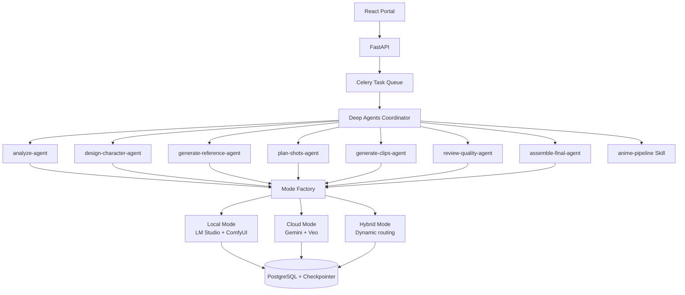

# anime-to-live-action-Short-generate-by-GenAI

**AI-Powered Japanese Anime to Cinematic Live-Action Short Film Generator**

Transform anime clips into high-quality, consistent-character live-action short films using **Deep Agents** with intelligent multi-mode support.

> **Official Repository**: https://github.com/johnsonhk88/anime-to-live-action-Short-generate-by-GenAI  
> **Learning Reference**: [DeepLearning.AI – AI Agents for Image and Video Generation](https://github.com/johnsonhk88/deep-learning-ai-AI-Agents-for-Image-and-Video-Generation)

**Current Status**: Phase 1 - Foundation & Deep Agents Scaffolding (July 2026)

---

## Vision

Build a production-grade, privacy-respecting full-stack platform that converts Japanese anime scenes into cinematic live-action short films with consistent characters.

The system is powered by **Deep Agents** (coordinator + subagent architecture with skills/tools) and supports **three flexible execution modes**:

- **Fully Local** — Maximum privacy and offline capability
- **Fully Cloud** — Highest visual quality and speed
- **Hybrid Mode** — Best balance of cost, privacy, and quality (recommended)

---

## Supported Modes

| Mode            | Analysis       | Image References     | Video Generation     | Best For                              |
|-----------------|----------------|----------------------|----------------------|---------------------------------------|
| **Fully Local** | LM Studio      | ComfyUI              | ComfyUI Video        | Privacy, offline, low cost            |
| **Fully Cloud** | Gemini         | Gemini Imagen        | Veo 3.1              | Highest cinematic quality             |
| **Hybrid**      | LM Studio      | ComfyUI              | Veo 3.1              | Best balance (recommended)            |

**Hybrid Mode** allows per-step configuration (e.g., use local for analysis, cloud for final video generation).

---

## Key Features

- **3-Mode Support**: Local / Cloud / Hybrid (with fine-grained control)
- **Deep Agents** coordinator with 7 custom subagents and skill-based workflow
- **Quality review loop**: Automatic regeneration when clips don't meet quality threshold
- Consistent character generation across multiple shots
- Cinematic final assembly using **Revideo**
- Modern React + FastAPI web portal (planned)
- Clean, extensible Python architecture

---

## Architecture

The pipeline uses the **Deep Agents** framework (built on LangGraph) with a **coordinator + subagent** pattern:



### Pipeline Steps

| Step | Subagent | Tools | Output |
|------|----------|-------|--------|
| 1. Analyze | `analyze-agent` | `analyze_anime_clip`, `extract_frames`, `detect_characters` | Scenes, characters, motion data, style notes |
| 2. Design Characters | `design-character-agent` | `design_character_sheet`, `generate_expression_set` | Live-action character sheets |
| 3. Generate References | `generate-reference-agent` | `generate_reference_image`, `style_transfer_reference` | Reference image paths |
| 4. Plan Shots | `plan-shots-agent` | `plan_cinematic_shot`, `calculate_camera_movement` | Shot plan with camera, lighting, composition |
| 5. Generate Clips | `generate-clips-agent` | `generate_video_clip`, `apply_consistent_style` | Video clip paths |
| 6. Review Quality | `review-quality-agent` | `review_video_quality`, `check_character_consistency` | Pass/fail with score and feedback |
| 7. Assemble Final | `assemble-final-agent` | `assemble_final_video`, `add_transitions`, `render_final_output` | Final video path |

**Quality Loop**: If the review score is below 0.7 and iterations remain, the coordinator loops back to step 5 with regeneration feedback.

---

## Tech Stack (Phase 1)

- **Backend**: FastAPI + SQLAlchemy 2.0 + Alembic
- **Agent Framework**: **Deep Agents** (Coordinator + Subagent architecture)
- **Database**: PostgreSQL (application data + agent checkpoints)
- **Task Queue**: Celery + Redis
- **Local Stack**: LM Studio + ComfyUI
- **Cloud Stack**: Google Gemini + Veo 3.1
- **Containerization**: Docker Compose

---

## Project Structure

```
anime-to-live-action-Short-generate-by-GenAI/
├── backend/
│   ├── app/
│   │   ├── core/                    # Config + Mode definitions
│   │   │   ├── config.py            # Settings (.env configurable)
│   │   │   └── modes.py             # ExecutionMode enum + provider map
│   │   ├── services/
│   │   │   └── mode_factory.py      # Provider resolution per mode
│   │   ├── agents/                  # Deep Agents (coordinator + subagents)
│   │   │   ├── state.py             # PipelineState + response schemas
│   │   │   ├── graph.py             # Re-exports create_pipeline_agent
│   │   │   ├── pipeline.py          # create_pipeline_agent factory
│   │   │   └── tools/               # Tool implementations per step
│   │   │       ├── analysis.py
│   │   │       ├── character.py
│   │   │       ├── reference.py
│   │   │       ├── shot_planning.py
│   │   │       ├── video_generation.py
│   │   │       ├── quality_review.py
│   │   │       └── assembly.py
│   │   ├── integrations/
│   │   │   ├── local/               # LM Studio + ComfyUI (placeholder)
│   │   │   └── cloud/               # Gemini + Veo (placeholder)
│   │   ├── api/                     # REST API routers (placeholder)
│   │   ├── db/                      # SQLAlchemy models (placeholder)
│   │   └── main.py                  # FastAPI app with /health + /generate
│   ├── skills/
│   │   └── anime-pipeline/
│   │       └── SKILL.md             # Pipeline workflow skill
│   ├── .env.example                  # Environment variable template
│   ├── workflows/                   # ComfyUI workflows (placeholder)
│   ├── requirements.txt
│   └── pyproject.toml
├── frontend/                        # React portal (later phase)
├── docker-compose.yml
├── docs/
└── README.md
```

---

## Phase 1 — Completed

- [x] Project scaffolding with correct repository name
- [x] Deep Agents coordinator with 7 subagents and skill-based workflow
- [x] Tool stubs for all 7 pipeline steps with realistic mock data
- [x] FastAPI application with `/health` and `/generate` endpoints
- [x] Pipeline workflow skill (`SKILL.md`) with progressive disclosure
- [x] `PipelineState` + response format schemas for structured subagent output
- [x] Mode definitions (Local / Cloud / Hybrid) with provider factory
- [x] Environment-configurable settings via `.env` with friendly startup validation
- [x] Missing API key detection with setup instructions on startup
- [x] Virtual environment + Jupyter kernel for isolated testing
- [x] 5 model validation notebooks (LM Studio, ComfyUI, Gemini, Deep Agents, full pipeline)
- [x] 56 unit tests covering mode factory, config, tools, and API endpoints
- [x] `litellm` + `langchain-litellm` integration for multi-provider LLM support
- [x] `extract_content` helper for reasoning model response extraction (Qwen, DeepSeek-R1, etc.)

---

## Getting Started (Development)

```bash
# Clone the repository
git clone https://github.com/johnsonhk88/anime-to-live-action-Short-generate-by-GenAI.git
cd anime-to-live-action-Short-generate-by-GenAI

# Backend setup
cd backend
pip install -r requirements.txt  # or uv sync
cp .env.example .env             # create and configure your .env

# Run the API
uv run uvicorn app.main:app --reload --port 8000
```

API Documentation: http://localhost:8000/docs

### Testing the API

```bash
# Health check
curl http://localhost:8000/health
# {"status":"ok"}

# Run the generation pipeline (uses mock data until real AI integrations are wired)
curl -X POST http://localhost:8000/generate \
  -H "Content-Type: application/json" \
  -d '{"clip_path": "/path/to/anime.mp4", "mode": "hybrid", "max_iterations": 3}'
```

### Configuration

Copy the template and edit it:

```bash
cp backend/.env.example backend/.env
```

Example `.env`:
```env
AGENT_MODEL=google_genai:gemini-3.5-flash
DEFAULT_MODE=hybrid
MAX_PIPELINE_ITERATIONS=3
GOOGLE_API_KEY=your-key-here
```

The `agent_model` supports any model string in `provider:model` format (e.g., `openai:gpt-5.5`, `anthropic:claude-sonnet-4-6`).

> **Note**: If you start the server without configuring the required API key for your chosen model, the app will display a friendly error with setup instructions instead of a cryptic traceback.

---

## Testing & Validation

Validate all AI services before wiring real integrations. Run in order below.

### Step 1: Setup Environment

```bash
cd backend
python3 -m venv venv-backend-test
source venv-backend-test/bin/activate
pip install -r requirements.txt
python -m ipykernel install --user --name=venv-backend-test --display-name="Python (venv-backend-test)"
```

### Step 2: Validate AI Services (Jupyter Notebooks)

Open each notebook in VS Code, select kernel **Python (venv-backend-test)**, and run cells in order:

| Step | Notebook | What It Validates |
|------|----------|-------------------|
| 1 | `notebooks/01_test_lm_studio.ipynb` | LM Studio reachable, model list, text gen via direct HTTP + litellm + langchain-litellm |
| 2 | `notebooks/02_test_comfyui.ipynb` | ComfyUI reachable, workflow queue & execution |
| 3 | `notebooks/03_test_gemini.ipynb` | Gemini API key works, text gen via SDK + langchain, Vertex AI |
| 4 | `notebooks/04_test_deepagents.ipynb` | Deep Agents coordinator + subagent + tool invocation |
| 5 | `notebooks/05_test_full_pipeline.ipynb` | 7-step pipeline end-to-end, quality loop, FastAPI TestClient |

Each notebook confirms connectivity → verifies response format → flags integration gaps.

### Step 3: Run Unit Tests

```bash
cd backend
./venv-backend-test/bin/pytest tests/ -v
```

56 tests covering: mode factory, config/settings, all 7 tool modules, and FastAPI endpoints.

### Step 4: FastAPI Smoke Test

```bash
cd backend
./venv-backend-test/bin/uvicorn app.main:app --port 8000

# In another terminal:
curl http://localhost:8000/health
# {"status":"ok"}

curl -X POST http://localhost:8000/generate \
  -H "Content-Type: application/json" \
  -d '{"clip_path": "/test/anime.mp4", "mode": "hybrid", "max_iterations": 1}'
```

### Step 5: Wire Real AI Integrations

After all notebooks pass, replace mock tool data in `backend/app/agents/tools/*.py` with real calls to the validated AI services. Update `.env` to select your active provider/model.

---

## Development Roadmap

**Phase 1** (current): Foundation & Deep Agents scaffolding with mock tools.

**Phase 2** (next): Wire real AI integrations (LM Studio, ComfyUI, Gemini, Veo) into tool implementations.

**Phase 3**: Add Celery task queue for async pipeline execution with status tracking.

**Phase 4**: PostgreSQL database models, Alembic migrations, and checkpoint persistence.

**Phase 5**: React frontend portal and Docker Compose deployment.

---

**This is a living project.** We prioritize clean Python architecture, Deep Agents as the primary agent framework, and flexible multi-mode execution (Local / Cloud / Hybrid).

---

**Author**: Johnson (Chong Kit Sang)  
GitHub: [johnsonhk88](https://github.com/johnsonhk88)  
Started: July 2026
