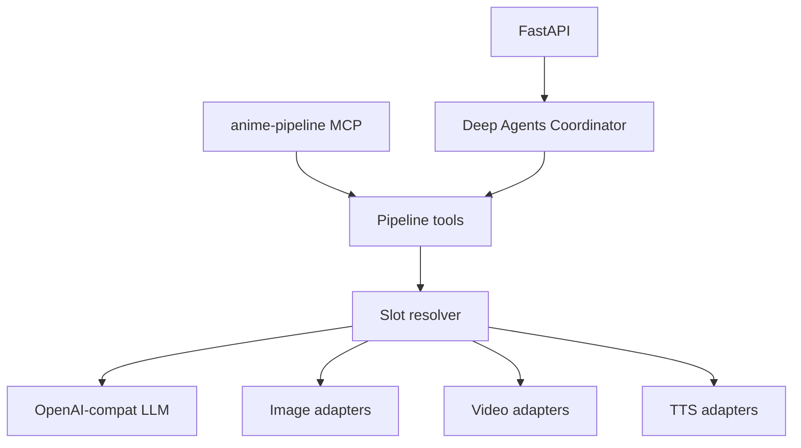

# anime-to-live-action-Short-generate-by-GenAI

**AI-Powered Japanese Anime to Cinematic Live-Action Short Film Generator**

Transform anime clips into consistent-character live-action shorts with **Deep Agents** and mix-and-match local/cloud providers.

> **Repo**: https://github.com/johnsonhk88/anime-to-live-action-Short-generate-by-GenAI

**Status**: Phase 2 — capability slots (LLM / image / video / TTS + MCP). Tools mock when `MOCK_PROVIDERS=true`.

---

## Vision

A privacy-respecting pipeline that converts Japanese anime scenes into cinematic live-action with consistent characters. Transport is **OpenAI-compatible REST** — not a Google-only stack, and not LiteLLM.

---

## Modes (defaults)

Env `LLM_PROFILE` / `IMAGE_PROVIDER` / `VIDEO_PROVIDER` / `TTS_PROFILE` override any cell. Full table: [docs/02-modes-and-slots.md](docs/02-modes-and-slots.md).

| Mode | LLM | Image | Video | TTS |
|------|-----|-------|-------|-----|
| **local** | LM Studio | vLLM-Omni Qwen-Image | MiniMax H3 | Qwen3-TTS |
| **cloud** | OpenRouter | GPT Image 2 | Seedance 2.5 | OpenAI speech |
| **hybrid** (default) | LM Studio | vLLM-Omni Qwen-Image | Seedance 2.5 | Qwen3-TTS |

Hybrid = local analysis + local refs + cloud Seedance video.

---

## 30-second start

```bash
cd backend
python3 -m venv .venv && source .venv/bin/activate
pip install -r requirements.txt
cp .env.example .env
# add: MOCK_PROVIDERS=true
uvicorn app.main:app --reload --port 8000

curl -s http://localhost:8000/health/slots | python3 -m json.tool
pytest tests/ -v
```

`GET /health/slots` is the source of truth for what will run.

**Next:** [docs/01-quickstart.md](docs/01-quickstart.md) · [docs/README.md](docs/README.md)

---

## Docs

| Guide | When to read |
|-------|----------------|
| [Quickstart](docs/01-quickstart.md) | Dry-run, pytest, first `/generate` |
| [Modes and slots](docs/02-modes-and-slots.md) | Pick local / cloud / hybrid and overrides |
| [Local engines](docs/03-local-engines.md) | LM Studio, vLLM, Omni, SGLang, Strata, Comfy |
| [Cloud providers](docs/04-cloud-providers.md) | OpenRouter, Seedance, GPT Image 2, Grok |
| [MCP](docs/05-mcp.md) | OpenCode / other agents |
| [HTTP API](docs/06-api.md) | `/health`, `/generate` |
| [Troubleshooting](docs/07-troubleshooting.md) | Keys, ports, mock fallback |
| [Env reference](backend/.env.example) | Every variable |

---

## Architecture



Pipeline: analyze → design characters → reference images → plan shots → generate clips → review → assemble + optional voice-over.

---

## Layout

```
backend/app/core/          # settings, modes, profiles
backend/app/services/      # llm / image / video / tts adapters
backend/app/agents/        # Deep Agents coordinator + tools
backend/app/mcp_server.py  # python -m app.mcp_server
backend/app/main.py        # FastAPI
backend/.env.example
docs/
```

---

## Roadmap

- **Phase 2** (current): live providers through slot adapters; Comfy H3/LTX workflow JSON still missing
- **Phase 3**: Celery for long Seedance jobs
- **Phase 4**: PostgreSQL + checkpoints
- **Phase 5**: React portal + Docker Compose

---

**Author**: Johnson (Chong Kit Sang) · [johnsonhk88](https://github.com/johnsonhk88) · Started July 2026
