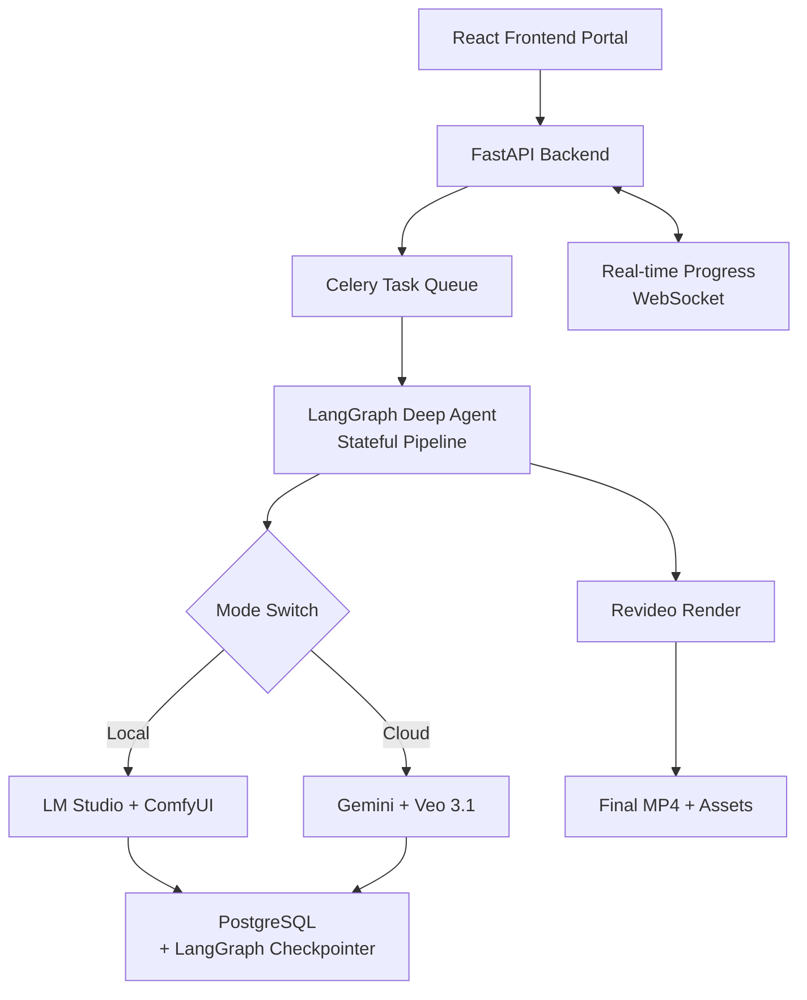

# Anime To Live Action Short Generate by GenAI

**AI-Powered Japanese Anime to Cinematic Live-Action Short Film Generator**

Transform anime clips into high-quality, consistent-character live-action short films using a dual-mode (Local / Cloud) pipeline powered by **LangGraph Deep Agents**.

> **Goal**: Build a production-grade, privacy-respecting tool that combines the best of local GPU workflows and powerful cloud models, all orchestrated through intelligent LangGraph agents.

---

## Vision

Create a full-stack web platform that allows users to:

- Upload short anime clips or scenes
- Automatically analyze and adapt them into realistic live-action style
- Generate consistent characters and cinematic video clips
- Assemble everything into a polished short film
- Choose between **fully local** (private, offline) or **cloud-powered** (maximum quality) execution

The system uses **LangGraph** as the core "Deep Agent" to intelligently orchestrate the entire pipeline with skills/tools, state persistence, and review loops.

---

## Key Features

- **Dual-Mode Architecture**
  - **Local Mode**: LM Studio + ComfyUI (full offline, privacy-first)
  - **Cloud Mode**: Gemini + Veo 3.1 (highest quality & speed)
- **LangGraph Deep Agent** with skills/tools and supervisor pattern
- **Stateful & Resumable** pipelines (powered by PostgreSQL checkpointer)
- **Consistent Character Generation** across multiple shots
- **Cinematic Final Assembly** using Revideo
- **Modern Web Portal** (React + FastAPI)
- **Production-ready stack**: FastAPI, LangGraph, Celery, PostgreSQL, Docker

---

## Architecture Overview



## Tech Stack

|Layer           |Technology                              |Notes                                   |
|----------------|----------------------------------------|----------------------------------------|
|Backend         |FastAPI + Pydantic                      |Core API layer                          |
|Agent Framework |LangGraph + LangChain Tools             |Deep Agent with skills                  |
|Database        |PostgreSQL                              |Application data + LangGraph checkpoints|
|Task Queue      |Celery + Redis                          |Background job execution                |
|Local Inference |LM Studio + ComfyUI                     |Privacy-first mode                      |
|Cloud Inference |Google Gemini + Veo 3.1                 |High-quality mode                       |
|Video Assembly  |Revideo (via subprocess)                |Programmatic cinematic editing          |
|Frontend        |React 19 + TypeScript + Vite + shadcn/ui|Modern portal UI                        |
|Containerization|Docker + Docker Compose                 |One-command development setup           |


## Dual Mode Support

|Feature         |Local Mode                              |Cloud Mode                              |
|----------------|----------------------------------------|----------------------------------------|
|LLM Analysis    |LM Studio                               |Gemini                                  |
|Image/Reference Gen|ComfyUI (Flux/SD3.5 + IP-Adapter)       |Gemini Imagen / Nano Banana             |
|Video Generation|ComfyUI Video Workflows                 |Veo 3.1                                 |
|Character Consistency|Excellent (ControlNet + IP-Adapter)     |Very Good (Reference + Chaining)        |
|Privacy         |100% Offline                            |Cloud processed                         |
|Cost            |Electricity only                        |Pay-per-use                             |
|Best For        |Personal projects, sensitive data       |Highest visual quality                  |


## Project Structure
```text
anime-real-forge/
├── backend/
│   ├── app/
│   │   ├── api/routers/          # FastAPI endpoints
│   │   ├── agents/               # LangGraph graph, state, tools
│   │   ├── services/             # Mode manager, integrations
│   │   ├── integrations/         # ComfyUI, Gemini, LM Studio, Revideo
│   │   ├── tasks/                # Celery tasks
│   │   ├── db/                   # SQLAlchemy models + Alembic
│   │   └── core/
│   ├── workflows/                # ComfyUI API JSON workflows
│   └── main.py
├── frontend/
│   └── src/                      # React + TypeScript portal
├── docker-compose.yml
├── pyproject.toml
├── README.md
└── docs/                         # Architecture decisions, prompts, etc.

```

-------------------------------------------

## Development Roadmap
### Phase 1: Foundation (Week 1–2)

- FastAPI + SQLAlchemy + Alembic + PostgreSQL setup
- Basic project CRUD + file upload
- Mode switcher service (Local / Cloud)
- Docker Compose environment
- Basic React frontend skeleton

### Phase 2: LangGraph Core (Week 3–4)

- Define PipelineState TypedDict
- Implement LangGraph tools/skills (@tool)
- Build Supervisor + Worker graph
- Add PostgreSQL checkpointer (AsyncPostgresSaver)
- Basic analysis node (Gemini + LM Studio)

### Phase 3: Generation Pipeline (Week 5–7)

- Character reference generation (dual mode)
- Shot planning & prompt engineering
- Video clip generation with consistency logic
- Quality review node + conditional routing

### Phase 4: Final Assembly & Polish (Week 8–9)

- Revideo integration (subprocess)
- Celery task wrapping for LangGraph runs
- WebSocket real-time progress updates
- Asset management & download

### Phase 5: Frontend & Release (Week 10+)

- Full React portal (tabs: Analysis → Characters → Clips → Final)
- Settings page (API keys, model selection, prompt templates)
- Error handling, retry, and resume support
- Documentation + example workflows


## Getting Started (Development)
#### Note: This section will be expanded once the initial scaffolding is complete.

```bash
# Clone the repository
git clone https://github.com/johnsonhk88/anime-real-forge.git
cd anime-real-forge

# Start all services
docker compose up -d

# Backend
cd backend
uvicorn app.main:app --reload

# Frontend (in another terminal)
cd frontend
npm install
npm run dev
```
------------------------

## Current Status
This repository is in early planning & scaffolding phase.
The architecture and technical decisions have been discussed and finalized:

- Pure Python codebase (no n8n)
- LangGraph as the central Deep Agent framework
- PostgreSQL for both data and agent checkpoints
- Dual-mode support from day one

-----------------


## Contributing
This is currently a solo development project. Once the core pipeline is stable, contributions will be welcomed — especially in:

- New ComfyUI workflows
- Improved consistency techniques
- Frontend UI/UX improvements
- Additional agent skills/tools

-----------------

## License
**MIT License (to be confirmed)**


--------------------------------
## Author
**Johnson Chong (Chong Kit Sang)**
**GitHub: johnsonhk88**
**LinkedIn / Kaggle: johnsonhk88**