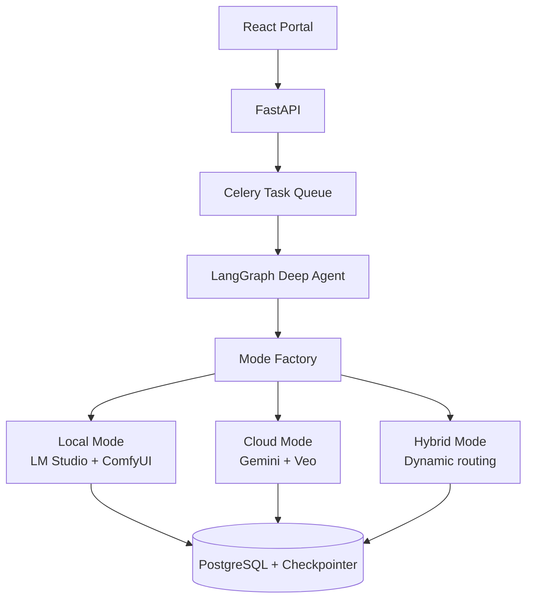

# anime-to-live-action-Short-generate-by-GenAI

**AI-Powered Japanese Anime to Cinematic Live-Action Short Film Generator**

Transform anime clips into high-quality, consistent-character live-action short films using **LangGraph Deep Agents** with intelligent multi-mode support.

> **Official Repository**: https://github.com/johnsonhk88/anime-to-live-action-Short-generate-by-GenAI  
> **Learning Reference**: [DeepLearning.AI – AI Agents for Image and Video Generation](https://github.com/johnsonhk88/deep-learning-ai-AI-Agents-for-Image-and-Video-Generation)

**Current Status**: Phase 1 - Foundation & LangGraph Deep Agent Scaffolding (July 2026)

---

## Vision

Build a production-grade, privacy-respecting full-stack platform that converts Japanese anime scenes into cinematic live-action short films with consistent characters.

The system is powered by **LangGraph** (Deep Agent with skills/tools) and supports **three flexible execution modes**:

- **Fully Local** — Maximum privacy and offline capability
- **Fully Cloud** — Highest visual quality and speed
- **Hybrid Mode** — Best balance of cost, privacy, and quality (recommended)

---

## Supported Modes

| Mode            | Analysis       | Image References     | Video Generation     | Best For                              |
|-----------------|----------------|----------------------|----------------------|---------------------------------------|
| **Fully Local** | LM Studio      | ComfyUI              | ComfyUI Video        | Privacy, offline, low cost            |
| **Fully Cloud** | Gemini         | Gemini Imagen        | Veo 3.1              | Highest cinematic quality             |
| **Hybrid**      | LM Studio      | ComfyUI              | Veo 3.1              | Best balance (recommended)            |

**Hybrid Mode** allows per-step configuration (e.g., use local for analysis, cloud for final video generation).

---

## Key Features

- **3-Mode Support**: Local / Cloud / Hybrid (with fine-grained control)
- **LangGraph Deep Agent** with skills/tools and supervisor pattern
- Stateful & resumable pipelines (PostgreSQL checkpointer)
- Consistent character generation across multiple shots
- Cinematic final assembly using **Revideo**
- Modern React + FastAPI web portal
- Clean, extensible Python architecture

---

## Architecture



---

## Tech Stack (Phase 1)

- **Backend**: FastAPI + SQLAlchemy 2.0 + Alembic
- **Agent Framework**: **LangGraph** (Primary Deep Agent)
- **Database**: PostgreSQL (application data + LangGraph checkpoints)
- **Task Queue**: Celery + Redis
- **Local Stack**: LM Studio + ComfyUI
- **Cloud Stack**: Google Gemini + Veo 3.1
- **Containerization**: Docker Compose

---

## Project Structure

```
anime-to-live-action-Short-generate-by-GenAI/
├── backend/
│   ├── app/
│   │   ├── core/                    # Config + Mode definitions
│   │   ├── services/                # Mode Factory + Pipeline Orchestrator
│   │   ├── agents/                  # LangGraph Deep Agent (primary)
│   │   │   ├── state.py
│   │   │   ├── graph.py
│   │   │   └── tools/
│   │   ├── integrations/
│   │   │   ├── local/               # LM Studio + ComfyUI
│   │   │   └── cloud/               # Gemini + Veo
│   │   ├── api/
│   │   ├── db/
│   │   └── main.py
│   ├── workflows/                   # ComfyUI workflows
│   └── pyproject.toml
├── frontend/                        # React portal (later phase)
├── docker-compose.yml
├── docs/
└── README.md
```

---

## Phase 1 — Completed

- [x] Project scaffolding with correct repository name
- [x] Docker Compose (PostgreSQL + Redis)
- [x] FastAPI basic application
- [x] SQLAlchemy models (`Project`, `Job`)
- [x] `PipelineState` with 3-mode support
- [x] Basic LangGraph graph + PostgreSQL checkpointer ready
- [x] Mode foundation prepared (Local / Cloud / Hybrid)

---

## Getting Started (Development)

```bash
# Clone the repository
git clone https://github.com/johnsonhk88/anime-to-live-action-Short-generate-by-GenAI.git
cd anime-to-live-action-Short-generate-by-GenAI

# Start infrastructure
docker compose up -d

# Backend setup
cd backend
uv sync                    # or pip install -e .
cp .env.example .env

# Run the API
uv run uvicorn app.main:app --reload --port 8000
```

API Documentation: http://localhost:8000/docs

---

## Development Roadmap

Detailed phases will be documented in `docs/roadmap.md`.

**Next**: Expand LangGraph with real analysis, image, and video generation tools supporting all three modes.

---

**This is a living project.** We prioritize clean Python architecture, LangGraph as the primary deep agent framework, and flexible multi-mode execution (Local / Cloud / Hybrid).

---

**Author**: Johnson (Chong Kit Sang)  
GitHub: [johnsonhk88](https://github.com/johnsonhk88)  
Started: July 2026
